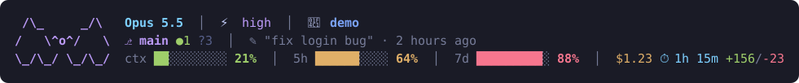

# 🦇 yarasa's statusline

A colorful 3-line status line for [Claude Code](https://claude.com/claude-code), with a bat.



- **Line 1:** model, effort level, agent name (with `--agent`), running subagents (count + names), current folder
- **Line 2:** git branch, ahead/behind, staged/modified/untracked/conflicts, last commit
- **Line 3:** context / 5-hour / 7-day usage bars (green → yellow → red) with time until reset, session cost, duration, lines changed

## Install

Requires [Node.js](https://nodejs.org) and `git`. No other dependencies.

1. Download `statusline.js` and `subagent-statusline.js` to `~/.claude/`.
2. Add this to `~/.claude/settings.json` (on Windows use forward slashes, e.g. `C:/Users/you/.claude/statusline.js`):

```json
{
  "statusLine": {
    "type": "command",
    "command": "node ~/.claude/statusline.js",
    "refreshInterval": 5
  },
  "subagentStatusLine": {
    "type": "command",
    "command": "node ~/.claude/subagent-statusline.js"
  }
}
```

`subagent-statusline.js` only records the running subagents of the session to a temp file so the main status line can show them; it keeps Claude Code's default subagent rows.

3. Restart Claude Code.

## Notes

- The last-commit age comes straight from git.
- Session duration is shown as `1h 15m`.

## License

MIT
